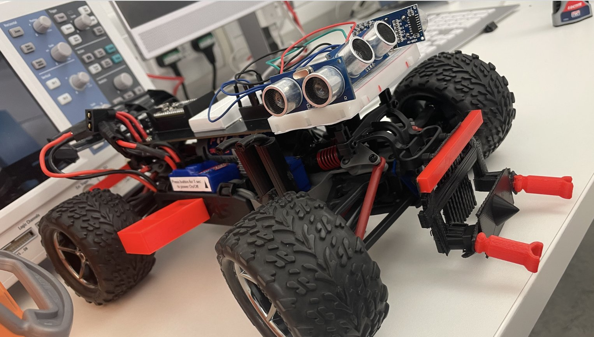
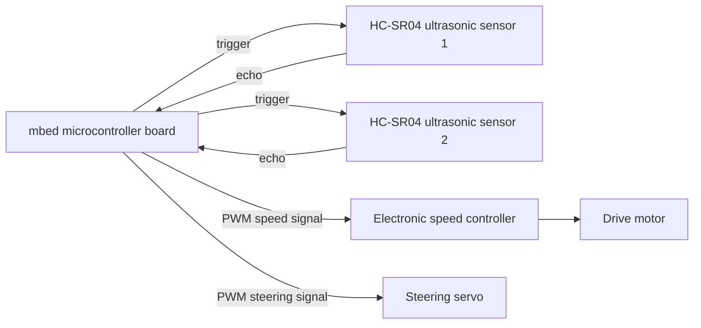
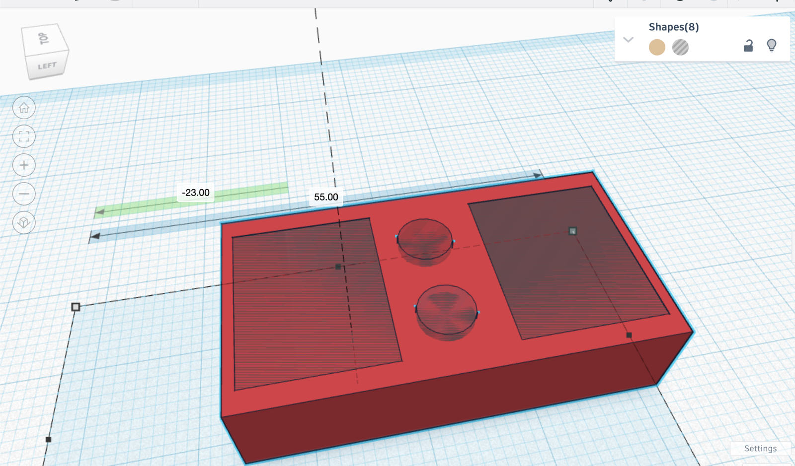
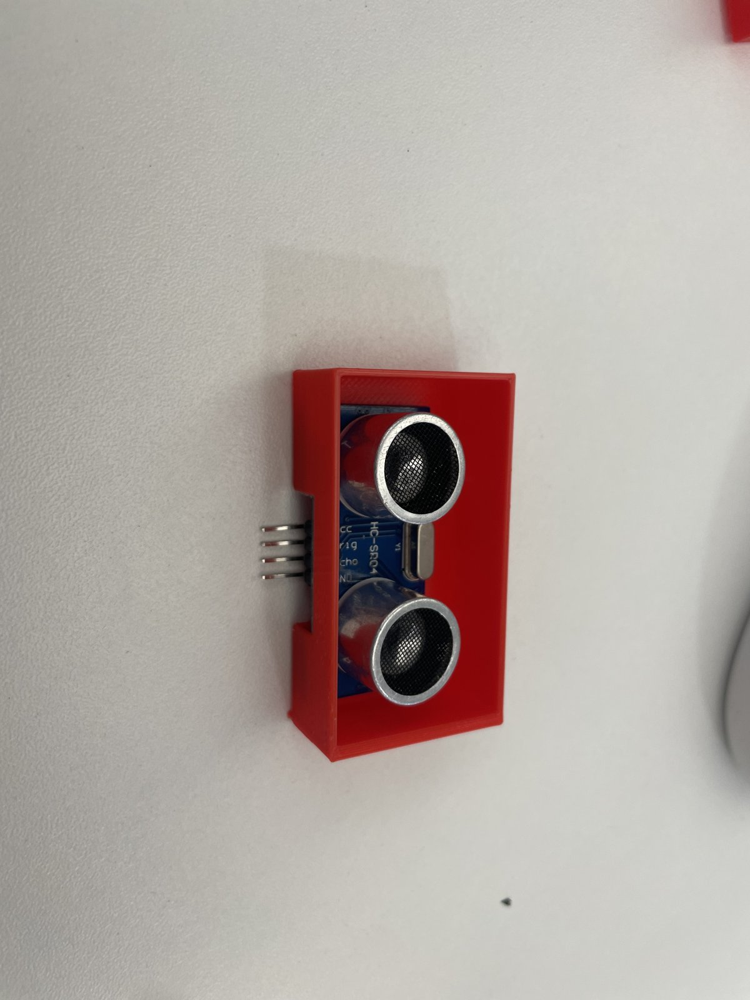
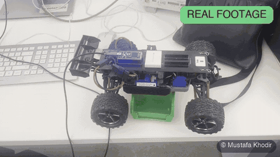
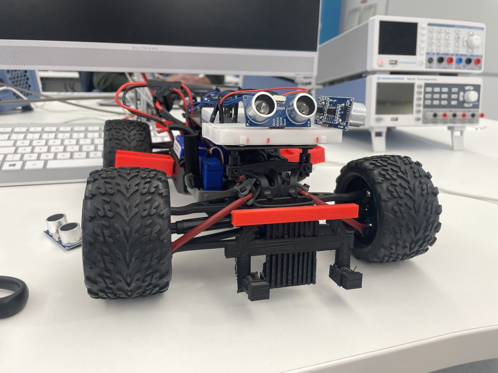

# Autonomous Delivery Vehicle for Elderly Care

A proof of concept for a small autonomous car that carries medication and snacks to older people in a care home. It drives itself using ultrasonic sensors to avoid walls and furniture, and carries the items in a 3D printed holder I designed. We called the product AFEX30, short for Autonomous For Elderly, and I made the logo and the slogan: "Driving a better future for our elderlies, a sensor reading at a time."

## What it does

- The car drives around on its own and uses two HC-SR04 ultrasonic sensors on the front to detect obstacles. When it gets close to something it stops and turns away instead of hitting it.
- A 3D printed holder on the car carries pills or a snack, with cut outs sized for pill pots, so the car can carry them on a delivery run.
- The speed is set in code using pulse width modulation, so the car can be made slower or faster for safety. We showed it accelerating and decelerating in the demos.
- Extra 3D printed parts give the car a front sensor mount, side holders and a set of exhaust style decorations so it looks like a finished product rather than a bare chassis.

The idea behind it was that older people living in care homes or alone often need medication at set times and do not always have someone free to bring it. This proof of concept shows a small, slow, sensor based car can carry those items while avoiding obstacles on the way, as a first step towards a delivery robot that works alongside carers.

## My role

This was a team project with four people, and I led it. I was team leader and Scrum project manager from the first week to the final demo. My part was:

- Came up with the product idea, the delivery car for medication and snacks, and sold it to the team.
- Chose the methodology we followed, a parallel Agile approach with sprints, stand ups and sprint planning, and ran it as Scrum master.
- Set up and ran Jira for the backlog, sprints and burndown charts, and set up the GitLab repository and file structure so everyone could work on their sections.
- Wrote the motion and steering code, working out how pulse width modulation controls the car's speed and where to change it, and helped test the sensor code.
- Designed the 3D printed parts and mounts, from hand sketches through TinkerCAD and SolidWorks models to the printed parts, then fitted them to the car. The parts include the medication holder, the front ultrasonic sensor holder, the side holders and the exhaust decorations.
- Designed the electronics and wiring and the software architecture for the car, using AutoCAD and SolidWorks for the design work.
- Wrote the one page technical research on PWM, I2C and SPI that we used when choosing how to connect the sensors.
- Built both the MVP and final presentations from scratch, created the AFEX30 logo and slogan, and wrote the marketing plan, product context and project management sections of the reports.

It was a team of four, and I shared the credit with my teammates in our report.

## How it works

### The car

The base is a Traxxas radio controlled car chassis fitted with an mbed microcontroller board that replaces the radio receiver. The mbed drives the car's electronic speed controller and steering servo, and reads the sensors. A breadboard on top carries the sensor wiring.

### Speed and steering

The speed controller takes a PWM signal. The pulse width sets how fast the car goes, so the motion code changes that pulse width to accelerate, decelerate and stop. I worked this out first with an mbed PWM speaker exercise, where changing the frequency changed the pitch, then applied the same idea to the car code. In the car code a wider pulse means a faster car, and steering is set the same way on the steering servo.

### Obstacle avoidance

Two HC-SR04 ultrasonic sensors sit in a printed holder on the front of the car. Each one sends a short ultrasonic pulse and times the echo, which gives the distance to the nearest object. The code reads both sensors in a loop. When a reading drops below the stop distance the car brakes, then steers away and carries on. Magnetic sensors were part of the design for sensing the route, with the ultrasonic sensors doing the collision avoidance.

### 3D printed parts

I sketched the car exterior and the holder on paper first, then modelled them in TinkerCAD and refined them in SolidWorks before printing. The medication holder started as a solid block with a cylinder subtracted from it to make the pill pot cut out, then grew into a two compartment tray in the second version. The front sensor holder has a slot that the HC-SR04 board slides into so the sensors sit square to the front of the car.

### What I learned from testing

The car delivered on time and ran well in the final demo. In testing I found that the ultrasonic sensors occasionally missed a plain white wall, so the car could stop too close to turn. The improvements I would make next are a third ultrasonic sensor on the back so the car can scan while reversing, and a longer stop distance so it always has room to turn. On the project side, I learned to close Jira issues as soon as they were done so the burndown chart always shows the true state of the sprint.

## Engineering case study

There is no code in this repo. The car code lived on the team's GitLab server, so this repo documents the build.

To rebuild the car you would need:

- A Traxxas radio controlled car chassis with its speed controller and steering servo.
- An mbed microcontroller board wired to the speed controller, the steering servo and the sensors, programmed with the mbed PWM and digital input libraries.
- Two HC-SR04 ultrasonic sensors, each needing 5V, ground, a trigger pin and an echo pin.
- The 3D printed parts, modelled from the CAD screenshots in this repo.

## What's in this repo

- `media/photos/` photos of the car during the build and finished, the printed parts and the sensor holder.
- `media/cad/` TinkerCAD screenshots of the car exterior, the medication holder, the sensor holder and the decorations. The last two are later revisions of the holder and bracket.
- `media/demo/` a short clip of the drive test.
- `media/figures/` my original hand sketch of the car exterior and the AFEX30 logo and slogan.

## Demo

**Drive test.** The car up on the bench with the wheels clear of the desk, running the drive motor. Real footage, played at 2x.

The full project report is available on request.

Copyright 2026 Mustafa Khodir. All rights reserved.
